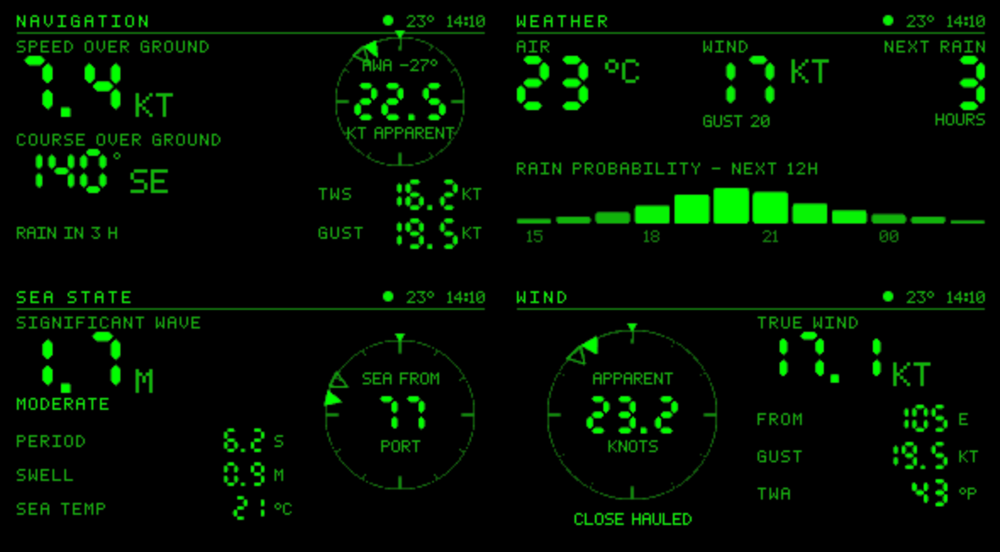
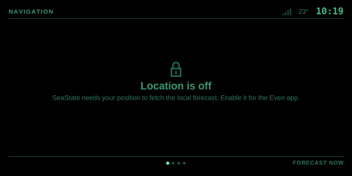
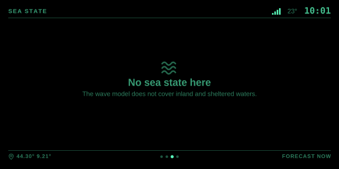
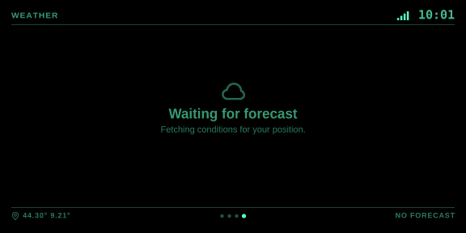

<div align="center">

<picture>
  <source media="(prefers-color-scheme: dark)" srcset="docs/readme/banner-dark.svg">
  
</picture>

<p>
  <a href="#quick-start"><b>Quick start</b></a> ·
  <a href="#screens"><b>Screens</b></a> ·
  <a href="#how-apparent-wind-works"><b>Apparent wind</b></a> ·
  <a href="#design-notes"><b>Design notes</b></a> ·
  <a href="#packaging-and-shipping"><b>Shipping</b></a>
</p>

</div>

TideView is a marine conditions HUD for [Even Realities G2](https://www.evenrealities.com) smart glasses. Speed, course, wind, sea state and weather sit on the lens, hands free, with **no instruments, no gateway and no boat wiring**. Everything comes from the phone's GPS and a public marine forecast, so it works the moment it is installed.

It is drawn with **[Glyph](https://github.com/gabrielevierti/glyph)**.

> [!NOTE]
> The repository and npm package are called `tideview`; on the glasses the app is called **SeaState** (set in `app.json`). The split comes from v1 and is kept so the `package_id` already reserved on the dev portal doesn't change.

<picture>
  <source media="(prefers-color-scheme: dark)" srcset="docs/readme/features-dark.svg">
  
</picture>



## Quick start

```bash
npm install
npm run dev
```

Open <http://localhost:5173>. Without an Even Hub bridge, the app mounts a preview that paints the same framebuffer the glasses receive, at the same 16 levels, scaled with nearest-neighbour so you see real pixels. Use `←` `→` to page, `1`–`4` to jump, `N` for night mode and `S` to switch surface style.

A browser tab has no boat, so copy `.env.example` to `.env` to run on synthetic conditions:

```
VITE_DEMO=1
```

The demo source is dev-only and can't be reached in a packaged build.

```bash
npm run sim        # preview inside the Even simulator instead
npm test           # ink, contrast, safe area, and nothing throwing
npm run snapshot   # re-render docs/screens/*.png
npm run font       # build the bitmap font atlas
```

The last three drive a real browser, so run this once per machine:

```bash
npx playwright install chromium
```

<details>
<summary><b>About the font atlas</b></summary>

<br>

`public/fonts/` is empty in the repository. Without an atlas, Glyph measures and rasterizes text with whatever fonts the host has: fine in a browser, unpinned on the device. `npm run font` renders every screen in every state with a style observer attached, collects the exact set of faces the app asks for (including the one-off sizes `fitStyle` lands on) and packs them into `public/fonts/inter.json`. Commit the result and text is identical everywhere.

The tool prints the family the browser *says* it resolved, but a computed `font-family` is the specified list, not the font actually used. A silent substitution on a machine without Inter installed won't be reported, so check the atlas visually the first time you build it.

</details>

## Screens

| Screen | What it shows |
| --- | --- |
| **Navigation** | Speed over ground with its trend, a compass rose with the wind on it, a compact apparent-wind dial, true wind and gusts, and enough of the sea to tell whether the sea screen is worth a look |
| **Wind** | Apparent and true wind on one boat-relative dial with the no-go zone marked; true wind speed and Beaufort force, direction, gusts, apparent wind angle and VMG to windward |
| **Sea state** | Significant wave height with the Douglas scale, the sea drawn in profile at its real steepness, period, swell, sea temperature and the side it is running from |
| **Weather** | Air temperature, wind with Beaufort, time to the next rain, and twelve hours of rain probability as a chart |

**Tap** advances a screen, **swipe up** goes back, **swipe down** toggles night mode and **double tap** exits. Night mode also turns on by itself outside daylight hours.

Every failure is a designed screen rather than a row of dashes: location denied, no fix yet, no wave model here, no forecast yet. They keep their status bar and page dots, so the app never looks like it has crashed.

<details>
<summary><b>Failure screens</b></summary>

<br>

| Location denied | No wave model | No forecast yet |
| --- | --- | --- |
|  |  |  |

</details>

## How apparent wind works

The forecast gives true wind; your GPS gives course and speed. Apparent wind is the vector sum of the two, so `src/wind.ts` solves it and the dial shows both: a filled arrow for apparent wind, a hollow one for true wind. The gap between them is the breeze your own boat is making.

The same calculation gives true wind angle, point of sail and VMG without a single sensor on the mast. It assumes no current and is only as good as the forecast, so treat it as situational awareness, not instrumentation. For deciding whether to bear away, though, it beats a bare wind direction in degrees.

## Design notes

**The tiling is quadrants, with no alternative.** An image container is capped at 288 × 144, and four of them cover 576 × 288 exactly, so the SDK's reference layout is the only shape that fits the cap and covers the screen. Glyph ships four other layouts, and the host rejects all of them at page creation (`image container size 576x32 exceeds maximum 288x144`).

**The columns are 170 / 192 / 170.** With the seams fixed at x = 288 and y = 144, each side panel stays inside one column of quadrants, so a changing speed readout doesn't resend the wind panel. The compass sits dead centre and crosses all four tiles: it is the one element that costs a full repaint, and only when the course changes.

**Outline, not filled.** Every lit pixel is a pixel of sea you can't see through. Panels are a hairline and their contents; nothing is a filled card. `npm test` enforces it: 3–4% ink per screen against Glyph's 18% budget. The `filled` style still exists, and the screenshots above are deliberately not drawn in it.

**Night mode is `app.brightness`.** One scalar, applied once at resolve, so the whole design dims together and no component needs to know. It is only written when it actually changes, because the setter forces a full four-tile repaint.

**Nothing is `animated`.** The paint loop idles until a fix, a forecast or the minute hand asks for a frame. A moored boat with a fresh forecast costs one tile every thirty seconds: the clock.

**Trends, not just instants.** `src/trend.ts` keeps a few minutes of speed and apparent wind in two ring buffers. One number can't tell you whether the breeze is building; a sparkline can, for a few hundred bytes.

**The sea profile is drawn from the numbers.** Wavelength comes from the period (deep water, λ = 1.56 T²), so the steepness on the lens is the steepness on the water. A 1.5 m six-second chop and a 1.5 m twelve-second swell share a number and are a completely different day.

### What changed in v2

The first version hand-rolled its own rasterizer (a supersampled canvas, a 5 × 7 bitmap font, seven-segment numerals, a palette) and drew into **one 288 × 144 container centred on the display**: a quarter of the panel, because managing four containers by hand wasn't worth it.

Glyph makes the whole surface cheap. v2 draws a full 576 × 288 framebuffer as four tiles and sends only the ones that changed. That deleted about 900 lines of graphics code (`src/gfx/`, `hud/chrome.ts`, `hud/dial.ts`) and gave four times the area to design in. What survived untouched is the part that was never about pixels: `models.ts`, `dataBus.ts`, `navigation.ts`, `wind.ts` and `sources/`. The apparent-wind solver is the same solver.

| | v1 | v2 |
| --- | --- | --- |
| Surface | 288 × 144, one container | 576 × 288, four tiles |
| Graphics | ~900 lines in this repo | `@gabrielevierti/glyph` |
| Transport | One full frame per change | Changed tiles only |
| Night mode | A second palette | One brightness scalar at resolve |
| Ink (outline) | Not measured | 3.1–4.1% per screen |

## Running on the glasses

### There is no way to ask whether you are on glasses

`waitForEvenAppBridge()` resolves in a plain browser tab. The SDK builds a bridge object whatever the host and only finds out there is nothing behind it when a call fails. So "did I get a bridge?" is the wrong question, and an app that relies on it will hide its own preview and then fail to start.

`app.ts` therefore *tries*: it creates the page of containers and treats a failure as an ordinary answer meaning "browser", not as an error. It is also the only reliable way to learn that a tile layout is illegal, since nothing on the client validates the 288 × 144 cap.

### Input and lifecycle

SeaState decodes the Even Hub event stream itself in `src/hub.ts` instead of using `GlyphRuntime.onInput`, for two reasons, both about review:

- The runtime folds every unrecognised system event into a tap, and the lifecycle codes (4–7) are unrecognised, so a foreground-enter would page the screen forward when the wearer unlocks their phone.
- A root page must call `shutDownPageContainer(1)` on double tap. The runtime keeps its bridge private, so an app that only talks to Glyph can't exit correctly.

Glyph still owns the transport: it is a rendering framework, and this is the part that isn't rendering.

## Packaging and shipping

```bash
npm run pack          # builds, then produces dist/seastate.ehpk
npm run pack:check    # validates the manifest and package_id availability
```

Upload the `.ehpk` through the [dev portal](https://hub.evenrealities.com), push it to your self-test group, and install it from **Me → Beta tester** in the Even Realities App.

> [!IMPORTANT]
> **Test location on a real install, not via QR.** QR sideloading doesn't grant location to the WebView: `watchPosition` fails with `PERMISSION_DENIED` and you'll see the "Location is off" screen whatever you do. Only a Hub-installed build (private, beta or released) gets a position fix, and the whole app depends on the GPS.

**Submission checklist**

- [x] The root page's double tap calls `shutDownPageContainer(1)`. Using `0` or a custom in-app exit is rejected automatically.
- [x] Lifecycle is handled in `src/hub.ts`: pause on `FOREGROUND_EXIT` (5), resume on `FOREGROUND_ENTER` (4), tear down on `ABNORMAL_EXIT` (6) and `SYSTEM_EXIT` (7). Suspending stops the GPS watch and the forecast poll, so a backgrounded app doesn't drain the battery.
- [x] Reviewers open the app, lock the phone for five minutes and unlock it. It should come back where you left it.
- [x] Reviewers also deny location to see what happens. That path is the "Location is off" screen.
- [x] No emergency-routing or safety-critical framing anywhere. SeaState reports conditions; it is not a navigation or collision-avoidance aid, and it deliberately has no depth alarm.

## Networking

Every request passes two independent gates: the `app.json` whitelist and ordinary CORS. The whitelist takes **full origins only, with no wildcards or bare hostnames**:

```json
"whitelist": ["https://api.open-meteo.com", "https://marine-api.open-meteo.com"]
```

That is why the app can't talk to your boat's NMEA gateway or Signal K server: those live on a LAN address that differs for every user and can't be whitelisted in advance, and plain `http://` isn't usable in production. Instrument support would need either a fixed list of well-known default gateway origins or a relay through a server you control.

Open-Meteo needs no API key and sets permissive CORS.

## Project layout

```
src/
  config.ts          tunables: rates, timings, lifecycle codes, brightness
  models.ts          Fix, Weather, Sea -> Conditions
  dataBus.ts         tiny observable store
  navigation.ts      bearings, distances, unit conversions
  wind.ts            apparent-wind solver and point of sail
  format.ts          how numbers become strings, once
  trend.ts           ring buffers behind the sparklines
  session.ts         night, demo, bridged
  sources/
    geolocation.ts   navigator.geolocation -> Fix
    forecast.ts      Open-Meteo weather + marine
    demo.ts          synthetic conditions, dev only
  hub.ts             Even Hub bridge: input, lifecycle, exit
  app.ts             Glyph app + runtime, input routing, night mode
  ui/
    chrome.ts        status bar, footer, the gated states
    instruments.ts   boat-relative dial, hull, wave profile, trend line
  screens/           one module per screen
  preview.ts         browser-only preview
tools/
  check.mjs          ink, contrast, safe area
  snapshot.mjs       reference screens
  build-font.mjs     bitmap atlas
```

## Licence

MIT. See [LICENSE](LICENSE).

---

<sub>Made by <a href="https://github.com/gabrielevierti">Gabriele Vierti</a> in Milan. SeaState reports conditions; it is not a navigation or collision-avoidance aid.</sub>
